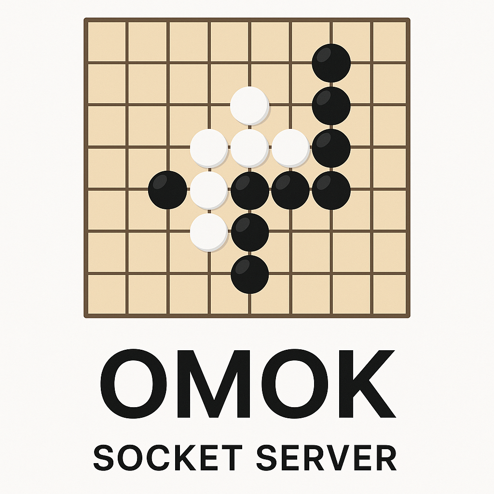

# Omok (오목) — WinForms Client + C# Socket Server

오목 네트워킹 게임의 클라이언트(WinForms)와 소켓 서버(C#)가 포함된 모노레포입니다. 간단한 로그인, 매칭, 게임 진행(돌 놓기/승패 판정)까지 동작하도록 구성되어 있습니다. 코드 스타일/PR/리뷰 가이드라인은 아래 문서들을 따릅니다: [`AGENTS.md`](AGENTS.md), [`AgentRef/coding_style.md`](AgentRef/coding_style.md), [`AgentRef/pr_rules.md`](AgentRef/pr_rules.md), [`AgentRef/review_guideline.md`](AgentRef/review_guideline.md), [`Client/AGENTS.md`](Client/AGENTS.md), [`SocketServer/AGENTS.md`](SocketServer/AGENTS.md)

## 저장소 구조

- 클라이언트(WinForms): [`Client/`](Client/)
  - 엔트리: [`Client/Program.cs`](Client/Program.cs)
  - 주요 폼: [`Client/MainForm.cs`](Client/MainForm.cs), [`Client/Forms/RoomEnterForm.cs`](Client/Forms/RoomEnterForm.cs), [`Client/Forms/OmokBoardForm.cs`](Client/Forms/OmokBoardForm.cs)
  - 네트워킹: [`Client/NetworkManager.cs`](Client/NetworkManager.cs), 패킷 처리: [`Client/Packet/`](Client/Packet/)
  - 프로젝트 파일: [`Client/Client.csproj`](Client/Client.csproj)
- 서버: [`SocketServer/`](SocketServer/)
  - 엔트리: [`SocketServer/Program.cs`](SocketServer/Program.cs)
  - 옵션: [`SocketServer/ServerOption.cs`](SocketServer/ServerOption.cs)
  - 게임로직: [`SocketServer/GameLogic/OmokBoard.cs`](SocketServer/GameLogic/OmokBoard.cs), [`SocketServer/GameLogic/OmokRule.cs`](SocketServer/GameLogic/OmokRule.cs)
  - 룸/유저/패킷: [`SocketServer/Rooms/`](SocketServer/Rooms/), [`SocketServer/Managers/`](SocketServer/Managers/), [`SocketServer/Packet/`](SocketServer/Packet/)
  - 프로젝트 파일: [`SocketServer/SocketServer.csproj`](SocketServer/SocketServer.csproj)
- 테스트: [`Client.Tests/`](Client.Tests/), [`SocketServer.Tests/`](SocketServer.Tests/)
- 문서/이미지: [`README.md`](README.md), [`omok.png`](omok.png), [`로그인확인.png`](로그인확인.png), [`매치매이킹.png`](매치매이킹.png), [`플레이화면.png`](플레이화면.png), [`결과화면.png`](결과화면.png)

## 스크린샷



[`omok.png`](omok.png)


[`로그인확인.png`](로그인확인.png)


[`매치매이킹.png`](매치매이킹.png)


[`플레이화면.png`](플레이화면.png)


[`결과화면.png`](결과화면.png)

## 요구 사항

- Windows 10/11 (클라이언트는 WinForms 기반)
- .NET SDK 9.0+

## 빠른 시작

1) 의존성 복원 및 빌드

- 클라이언트: [`Client/Client.csproj`](Client/Client.csproj)

```bash
dotnet restore Client/Client.csproj
dotnet build Client/Client.csproj -c Debug
```

- 서버: [`SocketServer/SocketServer.csproj`](SocketServer/SocketServer.csproj)

```bash
dotnet restore SocketServer/SocketServer.csproj
dotnet build SocketServer/SocketServer.csproj -c Debug
```

2) 서버 실행

서버는 명령행 옵션으로 설정값을 받습니다. 옵션 정의는 [`SocketServer/ServerOption.cs`](SocketServer/ServerOption.cs) 참고.

```bash
# 예시 (Program.cs 주석 참조)
dotnet run --project SocketServer/SocketServer.csproj -- \
  --uniqueID 1 --name OmokServer \
  --maxConnectionNumber 100 --port 5000 \
  --maxRequestLength 4096 \
  --roomMaxCount 16 --roomMaxUserCount 2 --roomStartNumber 1
```

관련 코드: [`C#.ParseCommandLine()`](SocketServer/Program.cs:62), [`C#.ServerOption`](SocketServer/ServerOption.cs:5)

3) 클라이언트 실행

```bash
dotnet run --project Client/Client.csproj
```

- 최초 실행 시, 네트워크 핸들러 등록 및 메인 폼을 구동합니다: [`Client/Program.cs`](Client/Program.cs)
- 기본 서버 주소/포트는 메인 폼 로드시 접속 시도 코드에서 설정합니다: [`Client/MainForm.cs`](Client/MainForm.cs)

4) 테스트 실행

- 클라이언트 테스트: [`Client.Tests/Client.Tests.csproj`](Client.Tests/Client.Tests.csproj)

```bash
dotnet test Client.Tests/Client.Tests.csproj
```

- 서버 테스트: [`SocketServer.Tests/SocketServer.Tests.csproj`](SocketServer.Tests/SocketServer.Tests.csproj)

```bash
dotnet test SocketServer.Tests/SocketServer.Tests.csproj
```

커버리지(예시):

```bash
dotnet test SocketServer.Tests/SocketServer.Tests.csproj -p:CollectCoverage=true -p:CoverletOutputFormat=cobertura
```

## 주요 구성 요소

- 클라이언트 네트워킹: [`Client/NetworkManager.cs`](Client/NetworkManager.cs)
  - TCP 연결/수신 루프/패킷 버퍼링 및 라우팅 담당
- 패킷 라우팅 및 정의: [`Client/Packet/PacketRouter.cs`](Client/Packet/PacketRouter.cs), [`Client/Packet/PacketDefine.cs`](Client/Packet/PacketDefine.cs), [`Client/Packet/PacketData.cs`](Client/Packet/PacketData.cs), [`Client/Packet/PacketBufferManager.cs`](Client/Packet/PacketBufferManager.cs)
- 서버 구동부: [`SocketServer/Program.cs`](SocketServer/Program.cs)
- 오목 규칙: [`SocketServer/GameLogic/OmokRule.cs`](SocketServer/GameLogic/OmokRule.cs)

## 개발 가이드

- 코딩 스타일: [`AgentRef/coding_style.md`](AgentRef/coding_style.md)
- PR 규칙: [`AgentRef/pr_rules.md`](AgentRef/pr_rules.md)
- 리뷰 가이드: [`AgentRef/review_guideline.md`](AgentRef/review_guideline.md)
- 클라이언트 가이드: [`Client/AGENTS.md`](Client/AGENTS.md)
- 서버 가이드: [`SocketServer/AGENTS.md`](SocketServer/AGENTS.md)

## 사용 라이브러리

- SuperSocketLite
- CommandLineParser
- MessagePack
- NLog.Extensions.Logging

## 트러블슈팅

- 방화벽/포트: 서버 포트(기본 예시 5000)가 열려있는지 확인
- 서버 옵션 누락: 필수 옵션은 모두 전달해야 합니다. 상세는 [`SocketServer/ServerOption.cs`](SocketServer/ServerOption.cs)
- 클라이언트 연결 실패: 서버가 먼저 실행 중인지 확인하고, [`Client/MainForm.cs`](Client/MainForm.cs)에서 설정한 주소/포트를 점검

---

Happy hacking!