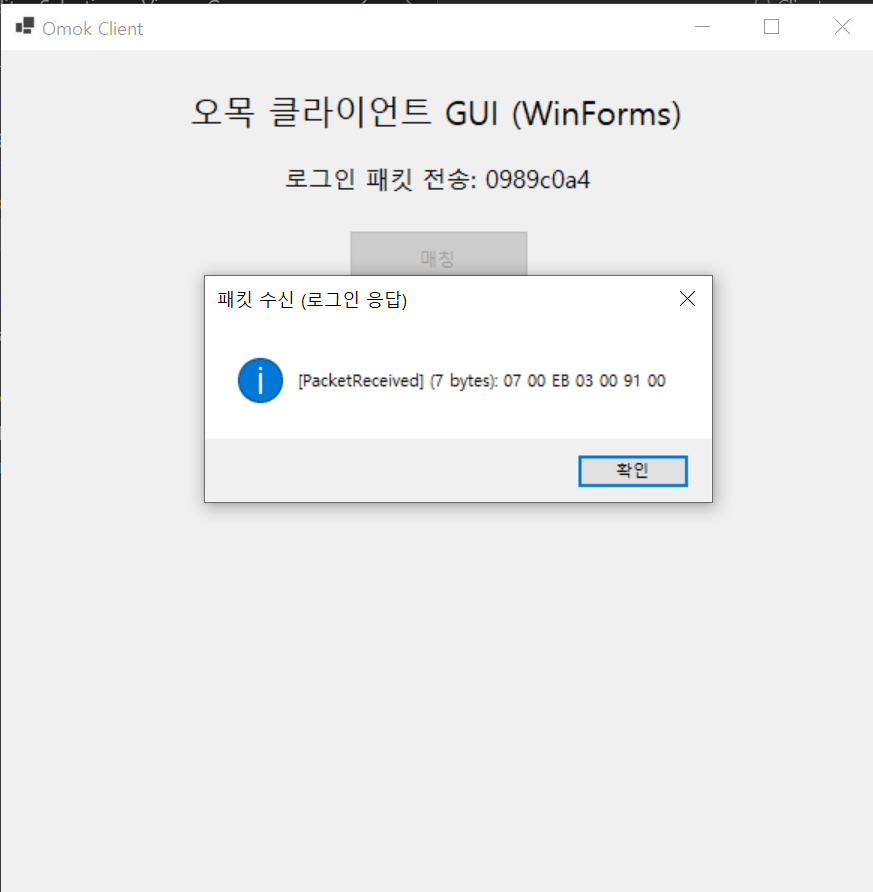
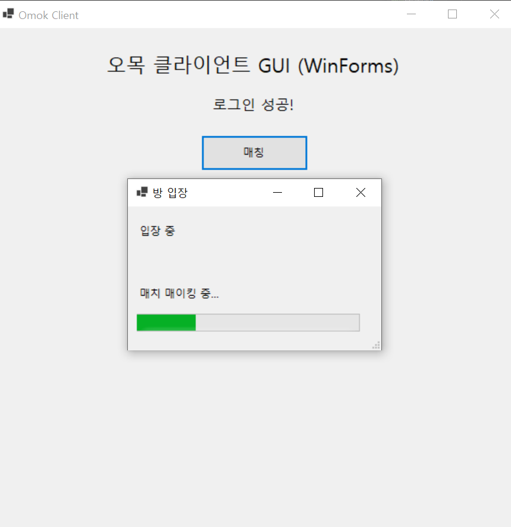
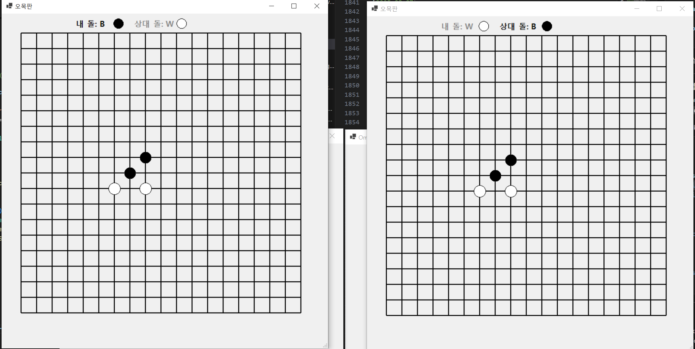
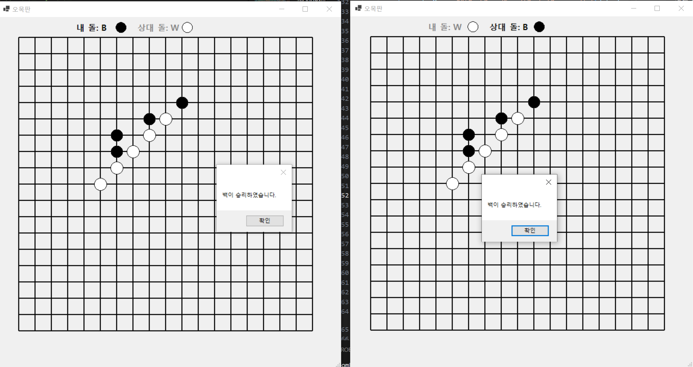

# Omok Socket Server & WinForms Client

Omok (Gomoku) project with a WinForms client and a TCP socket game server. The repository includes gameplay logic, room management, packet handling, and tests. This README covers setup, build/run instructions, development workflow, and contribution rules.

> Important: Follow the coding and PR/review guides under `AgentRef/` and the agent guides under each app folder. See links below.

## Project Structure

```
.
├─ Client/                     # WinForms client app (entry: Client/Program.cs)
│  ├─ Forms/                   # UI forms (login, room enter, board)
│  ├─ Packet/                  # Client packet buffer + router
│  ├─ Client.csproj            # net9.0-windows
│  └─ AGENTS.md                # Frontend agent guide
│
├─ SocketServer/               # Game server + core logic (entry: SocketServer/Program.cs)
│  ├─ GameLogic/               # Omok board + rules
│  ├─ Rooms/                   # Room + RoomManager
│  ├─ Handlers/                # Connection, Room handlers
│  ├─ Packet/                  # Packet IDs, data, processor
│  ├─ Users/                   # User + UserManager
│  └─ SocketServer.csproj      # net9.0
│
├─ Client.Tests/               # Client-side tests (xUnit)
├─ SocketServer.Tests/         # Server-side tests (xUnit)
├─ AgentRef/                   # Coding style, PR rules, review guideline
├─ docs/                       # Additional docs placeholders
├─ README.md                   # This file
└─ AGENTS.md                   # Repo-level agent notes
```

Key entry points:
- Client: `Client/Program.cs`
- Server: `SocketServer/Program.cs`

Guides to follow:
- Coding style: `AgentRef/coding_style.md`
- PR rules: `AgentRef/pr_rules.md`
- Review guideline: `AgentRef/review_guideline.md`
- Client guide: `Client/AGENTS.md`
- Server guide: `SocketServer/AGENTS.md`

## Requirements

- .NET SDK 9.0+
- Windows (for WinForms client: `net9.0-windows`)

## Quick Start

1) Build everything

```
dotnet build
```

2) Run the server

The server takes explicit command-line options. Example:

```
dotnet run --project SocketServer/SocketServer.csproj -- \
  --uniqueID 1 \
  --name OmokServer \
  --maxConnectionNumber 100 \
  --port 5000 \
  --maxRequestLength 4096 \
  --roomMaxCount 16 \
  --roomMaxUserCount 2 \
  --roomStartNumber 1
```

Press `q` in the server console to shut it down.

3) Run the WinForms client

```
dotnet run --project Client/Client.csproj
```

In the UI, connect to your server host/port (e.g., `127.0.0.1:5000`). Use the login/matchmaking flow to start a game.

## Testing

Run all tests:

```
dotnet test
```

Notable tests:
- Server rules: `SocketServer.Tests/GameLogic/OmokRuleTests.cs`
- Client packets: `Client.Tests/Packet/PacketRouterTests.cs`

## Tech Notes

- Networking: `SuperSocketLite`
- Serialization: `MessagePack`
- Logging: `NLog.Extensions.Logging`

Client specifics:
- Target framework: `net9.0-windows`
- Forms in `Client/Forms/`
- Packet routing via `Client/Packet/PacketRouter.cs`

Server specifics:
- Target framework: `net9.0`
- Gameplay: `SocketServer/GameLogic/`
- Rooms: `SocketServer/Rooms/`
- Packets: `SocketServer/Packet/`

## Screenshots

Login / Matchmaking / Play / Result examples:






## Development Workflow

- Follow repo-wide agent notes: `AGENTS.md`
- Frontend tasks: `Client/AGENTS.md`
- Backend tasks: `SocketServer/AGENTS.md`
- Adhere to style guide: `AgentRef/coding_style.md`
- Write focused commits and PRs: `AgentRef/pr_rules.md`
- Check what reviewers look for: `AgentRef/review_guideline.md`

Recommended branches:
- Feature: `feat/<scope>`
- Fix: `fix/<scope>`
- Docs: `docs/<scope>`
- Refactor: `refactor/<scope>`

## Contribution

1) Create a branch

```
git checkout -b docs/readme-update
```

2) Make changes and commit following the PR rules.

3) Push and open a PR targeting `main`.

## Troubleshooting

- Build issues: ensure `.NET 9 SDK` is installed and selected (`dotnet --version`).
- WinForms: run on Windows with `net9.0-windows` and Visual Styles enabled.
- Server startup: confirm required CLI options are provided (see example above).
- Network: verify firewall allows the chosen server port.

## License

No explicit license file is present. Treat as private/internal unless stated otherwise by repository owners.
